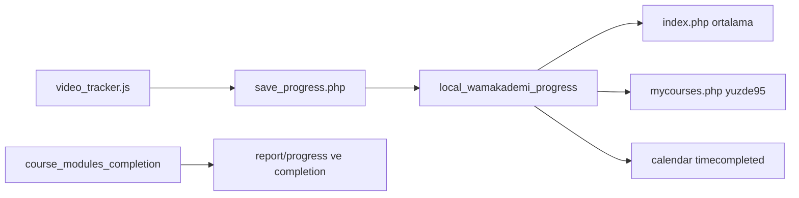

# Eğitim ilerlemesi ve raporlama analizi

Bu belge yerel kod ve `wam_academy_local` verisine dayanır. Canlı sunucu bu turda doğrulanmadı. Kod, veritabanı, commit, push ve deploy yapılmayacak. Content Workflow R1, rol modeli ve mevcut arayüzler değiştirilmeyecek.

## 1. Özel raporlar neden boş

Sayfa Moodle çekirdeğinin `core_reportbuilder` listesidir: [public/reportbuilder/index.php](public/reportbuilder/index.php), yönetim sayfası `customreports` ([public/admin/settings/reportbuilder.php](public/admin/settings/reportbuilder.php)). URL: `/reportbuilder/index.php`.

Yerelde `enablecustomreports = 1`. `mdl_reportbuilder_report` içinde 8 satır var; hepsi `type = 1` (sistem raporu: kullanıcı listesi, rozetler, not özeti, rapor listesinin kendisi). `mdl_reportbuilder_audience` boş. Özel rapor (`type = 0`) sayısı sıfır. Liste yalnızca özel raporları gösterir ve izleyiciye göre süzer: `viewall`/`editall` yoksa yalnızca hedef kitlesinde olunan veya kullanıcının oluşturduğu raporlar gelir ([public/reportbuilder/classes/local/helpers/audience.php](public/reportbuilder/classes/local/helpers/audience.php)).

Boş ekran, rapor altyapısının yokluğu değildir. Özel rapor hiç oluşturulmamıştır. Sistem raporları başka ekranların içindedir ve bu listeye düşmez.

Erişim: `moodle/reportbuilder:view` kimliği doğrulanmış herkese (`user` arketipi) açıktır; WAM menüsü de bu yetkiyle bağlantı verir. Oluşturma `moodle/reportbuilder:edit` ister; bu yetki `manager` arketipindedir ve site yöneticisi her yetkiye sahiptir. Akademi yöneticisi rolünde bu yetkiler yok. Öğrenci sayfayı açar, satır görmez.

## 2. Mevcut rapor yolları

Moodle, kurs bağlamı (`report/*:view`, kurs bağlamı; `editingteacher`, `teacher`, `manager`):

- `/report/progress/index.php` etkinlik tamamlama. Veri `course_modules_completion`. Yerelde 0 satır; kurs modüllerinde `completion = 0`.
- `/report/completion/index.php` kurs tamamlama. Veri `course_completions`. Yerelde 0 satır. `enablecompletion` site genelinde 1; kurs 1, 2 ve 7 kapalı, yalnızca test kursu 5 açık.
- `/report/log/index.php`, `/report/outline/index.php`, `/report/participation/index.php` günlük ve katılım. Video yüzdesi üretmez.
- `/report/courseoverview/index.php` site geneli kayıt sayıları; `report/courseoverview:view`.
- Not defteri: `/grade/report/grader/index.php` ve kullanıcı not raporu. `gradereport/grader:view` öğretmen rollerinde. Yerelde `finalgrade` dolu satır 0.

WAM ekranları, yalnızca oturumdaki kullanıcının kendi kayıtları:

- `/local/wamakademi/index.php` ana sayfa yüzde ve tamamlandı sayacı.
- `/local/wamakademi/mycourses.php` eğitim listesi, yüzde ve durum etiketi.
- `/local/wamakademi/calendar.php` takvimdeki kurs tamamlanması.

WAM’a özel bir reportbuilder veri kaynağı yok. Aynı iş için ikinci bir rapor motoru gerekmez; ya Moodle özel raporu ya da mevcut WAM ilerleme tablosunu okuyan sınırlı bir görünüm yeter.

## 3. Video ve eğitim ilerlemesi

Kayıt: `enrol_get_users_courses`. Video satırı: [public/local/wamakademi/db/install.xml](public/local/wamakademi/db/install.xml) `local_wamakademi_progress` (`userid`, `cmid`, `currenttime`, `duration`, `watchedseconds`, `watchedranges`, `progress`, `completed`, `timecompleted`).

Yazma: [public/local/wamakademi/save_progress.php](public/local/wamakademi/save_progress.php) ve [public/local/wamakademi/js/video_tracker.js](public/local/wamakademi/js/video_tracker.js).

- Aralıklar birleşir; `watchedseconds` aralıkların birleşimidir, tekrar izleme süreyi ikiye katlamaz ve değer düşmez.
- `progress = round(watchedseconds / duration * 100)`, 0–100, geriye gitmez.
- `completed = 1` eşik `progress >= 95`. `timecompleted` yalnızca `progress >= 100` iken yazılır.
- `currenttime` son konumdur; izlenen süreyle aynı şey değildir.
- 3 saniyeden büyük sıçrama aralığa yazılmaz; ileri sarma izlenmiş sayılmaz.
- Önizleme (`manageactivities`, gizli etkinliği görme veya site yöneticisi) kayıt yazmaz.
- Görünmeyen etkinlik ve taslak (`visible = 0`) öğrenciye yazılmaz. Yükleme Moodle etkinlik tamamlamasını 0 yapar.

Yerel kanıt: 2 ilerleme satırı, ikisi de kullanıcı 3. `cmid 4`: %40, completed 0. `cmid 11`: %100, completed 1, `timecompleted` dolu.

Üç ayrı “tamamlandı” kuralı var; tek bir eğitim yüzdesi yok:

- Ana sayfa ([index.php](public/local/wamakademi/index.php) 37–64): yalnızca ilerleme satırı olan yayımlı videoların `progress` ortalaması. Satırı olmayan video paydaya girmez. Kurs tamamlandı sayılır eğer ortalama `>= 100`.
- Eğitimlerim ([mycourses.php](public/local/wamakademi/mycourses.php) 92–130): tüm yayımlı dersler paydaya girer (satır yoksa 0). Tamamlandı: `completed = 1` olan ders sayısı, yayımlı ders sayısına eşit. Eşik fiilen %95.
- Takvim: her yayımlı dersin `timecompleted` dolu olması. Eşik %100.

Görünmeyen etkinlik bu üç hesabın dışındadır. Moodle `course_completions` bu yüzdelerin kaynağı değildir.

## 4. Ödev ve değerlendirme

`mod_assign` kurulu. Yerelde kurs 2’de bir ödev (`WAM Test Ödevi`, not skalası 100, `duedate` ve `cutoffdate` 0). İki teslim kaydı `status = new` (taslak); not satırı yok. `mdl_quiz` 0. Not defterinde sonuç yok.

Durumların yeri: teslim `assign_submission.status`, not `assign_grades` ve not defteri, son tarih `assign.duedate`. Gecikme türetilir; ayrı kolon yok. Öğrenci `mod/assign:submit` ve `view`. Not verme `mod/assign:grade` öğretmen ve manager arketiplerinde. Akademi yöneticisine bu yetkiler verilmedi. Eğitmen, kayıtlı olduğu kurstaki ödevi notlandırabilir.

Bu veri Moodle not ve ödev ekranlarından okunabilir. WAM raporu yok. Sınav hiç kullanılmadığı için sınav raporu doğrulanamaz.

## 5. Organizasyon verisi

`user.department` ve `user.institution` altı gerçek kullanıcıda boş. Şirket veya departman hiyerarşisi tablosu yok. Raporlarda bu alanlar varmış gibi kullanılmamalı.

## 6. Roller

- Site yöneticisi (`siteadmins` = kullanıcı 2): tüm raporlar, oluşturma ve tüm kullanıcı verisi.
- Akademi yöneticisi (`academymanager`, kategori bağlamı): kurs oluşturma, kayıt, eğitmen atama. Rapor, not ve özel rapor yetkisi yok. Menüde görünmemesi tek başına kanıt değildir; capability satırında da yok. Kategori dışına çıkmamalı.
- Eğitmen (`editingteacher`, kurs bağlamı): kayıtlı olduğu kursta ilerleme, tamamlama, günlük ve not raporları. Özel rapor oluşturamaz. Başka kursun verisini göremez.
- Öğrenci: kendi ana sayfa, Eğitimlerim ve takvim ilerlemesi; kendi ödev teslimi. Başkasının satırını okuyan bir WAM sorgusu yok. Özel rapor listesini açabilir, satır yoktur.

## 7. Önerilen görünümler

- Eğitim bazında: kayıt `user_enrolments`; başlamayan / devam / tamam ayrı eşik kararı ister. Kişi satırı ilerleme tablosundan üretilebilir. Eksik: tek tamamlanma tanımı ve eğitmen/akademi yöneticisi için başkasını listeleyen ekran.
- Kullanıcı bazında: öğrenci kendi listesini görür. Yönetici görünümü yok.
- Video bazında: `watchedseconds / duration` ve `completed`. Eğitim yüzdesinden ayrı tutulmalı.
- Ödev bazında: mevcut assign tabloları. Gecikme ancak `duedate > 0` ise anlamlı. Yerelde tarih yok.
- Yönetim özeti: kategori kapsamı şart. Departman kırılımı veri olmadan yok.

Filtre (tarih, eğitim, kullanıcı, durum) ve dışa aktarma WAM ekranlarında yok. Moodle özel raporu ve kurs raporları CSV indirebilir; veri kaynağı WAM tablosunu kapsamaz.

## 8. Karar noktaları

Uygulamadan önce seçilmeli:

- Eğitim tamamlandı: tüm videolar `%95` (`completed`) mi, tümü `%100` (`timecompleted`) mi, ortalama mı.
- Satırı olmayan video: 0 mı sayılacak, yoksa ana sayfadaki gibi dışarıda mı kalacak.
- Rapor tüketicisi: önce eğitmen kursu mu, akademi yöneticisinin kategorisi mi. Özel rapor oluşturma site geneli yetki ister; kategori rolüne verilirse kapsam Moodle hedef kitlesiyle ayrıca sınırlanmalıdır.
- Ödev raporu, en az bir kursta son tarihi ve teslimi olan gerçek ödevle mi doğrulanacak.

## 9. Fazlar

Her faz küçük ve yerel doğrulamalı. Bir faz bitmeden sonrakine veri tanımı taşınmamalı.

- Faz 0: Tamamlanma kuralını seç. Ana sayfa, Eğitimlerim ve takvimi aynı kurala bağlama işi ayrı ve mevcut UI işine dokunmadan yapılabilir.
- Faz 1: Eğitmenin kendi kursunda kişi ve video ilerlemesini gösteren salt okunur görünüm. Kaynak yalnızca `local_wamakademi_progress` ve kayıt. Yetki kurs bağlamında `report/progress:view` veya eşdeğeri; akademi yöneticisine bu fazda site geneli rapor açılmaz.
- Faz 2: Aynı kurs için kullanıcı bazında eğitim listesi. Filtre: kullanıcı, durum. Dışa aktarma bu görünüm oturunca.
- Faz 3: Ödev durumu. Yalnızca `assign` tabloları; gecikme `duedate` doluysa. Quiz bu fazda yok.
- Faz 4: Akademi yöneticisi için atandığı kategori altındaki kurs özeti. Departman kırılımı bu fazın dışında.
- Faz 5: İhtiyaç sürerse Moodle reportbuilder veri kaynağı. Ayrı bir rapor motoru yazılmaz.

## 10. Test ve risk

- Öğrenci yalnızca kendi satırını görür; başka `userid` ile URL denemesi reddedilir.
- Eğitmen kurs 2’de kullanıcı 3’ün %40 ve %100 satırını görür; kurs 5’te o satırlar yoktur.
- Akademi yöneticisi kategori 1 dışındaki kursu açamaz.
- Site yöneticisi önizlemede ilerleme yazmamalı; öğrenci görünmeyen taslağa yazmamalı.
- Aynı videoyu tekrar izlemek ve ileri sarmak `watchedseconds` değerini şişirmemeli.
- %95 ile %100 farkı: `completed` dolu, `timecompleted` boş senaryosu üç ekranda aynı sonucu vermeli. Şu an vermiyor.
- Ödev taslağı (`new`) teslim edilmiş sayılmamalı. Son tarihsiz ödev gecikmiş sayılmamalı.
- Boş department ile gruplama yapılmamalı.
- Canlı sunucu ve üretim rol tablosu bu analizde doğrulanmadı. Yereldeki 2 ilerleme satırı ve 1 ödev örnek veridir, üretim hacmi değildir.
